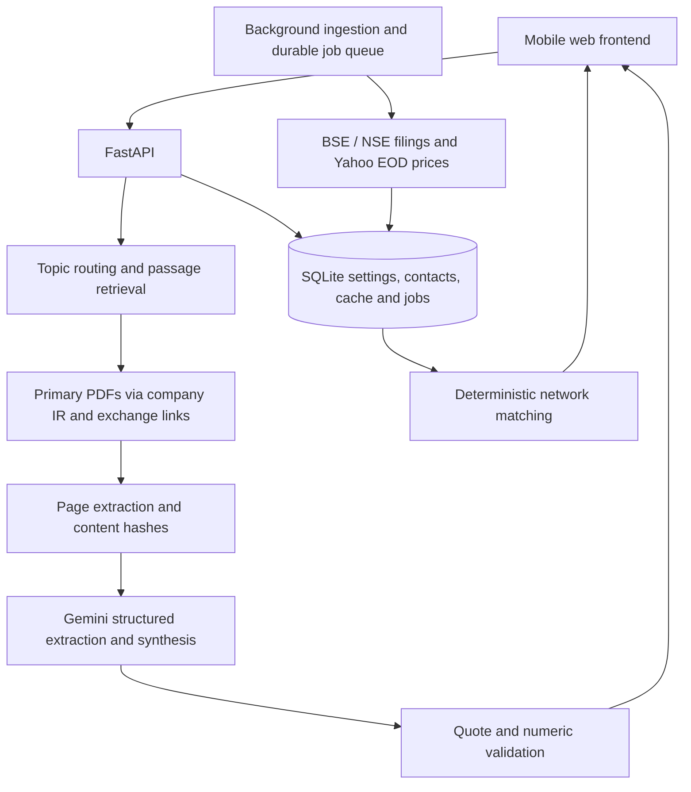

# FINN — investment research with network context

FINN is a mobile-first prototype for an investor who needs to understand what changed, inspect the underlying evidence, and identify someone in their network who can help explain it. It combines a portfolio briefing, on-demand research and a professional network in one daily workflow.

## What I built

Today is the Push view. A configurable time window defaults to 24 hours, material filings appear before routine disclosures, and alerts explain the threshold or announcement preference that triggered them. Filing cards connect to relevant contacts and to deeper research. Preferences holds the watchlist, alert thresholds and digest defaults.

Research accepts NSE tickers beyond the demo portfolio. It retrieves primary annual reports, earnings-call transcripts and relevant event filings, selects passages, and asks Gemini to produce claims with source IDs and exact supporting quotes. The interface exposes original documents, page numbers, excerpts and coverage gaps. A question can also be monitored against subsequent filings.

The Network records employment, roles, tenure, education, major, expertise and explicit introductions. Recommendations explain their basis. Twelve fictional profiles provide overlap with the demo companies. All synthetic profiles are labelled. Manual entry works independently of profile import. LinkedIn import uses accessible public or indexed content and returns an editable draft, with pasted profile text as a fallback.

## Product decisions and tradeoffs

The four-tab layout gives each task a clear place while bringing network context into Push and Pull. Routine filings remain available but collapsed. The investor controls what counts as unusual through price, volume and announcement preferences. EOD market alerts reflect completed trading sessions.

Research retrieves documents on demand and caches them. This keeps the engine applicable to companies outside the portfolio. Explicit source failures and incomplete answers are part of the interface. One automatic repair attempt handles malformed or entirely unverifiable model output. Exact quote and numeric checks reduce unsupported output, but do not establish semantic entailment or correct financial interpretation.

## Architecture and data pipelines

The frontend uses HTML, CSS and JavaScript served by FastAPI. SQLite stores portfolio preferences, contacts, caches, alert identities and durable analysis jobs. A background worker polls sources every 15 minutes and processes queued analyses separately from ingestion. The prototype runs with one API process.

BSE is the first announcement source, with an NSE fallback. Yahoo Finance provides EOD prices and volumes. Screener links and company investor-relations pages locate primary PDFs. Tavily provides restricted document discovery when needed. Research evidence comes from downloaded documents. Files retain page numbers and content hashes. Caches reuse discovery, documents and answers, and repeated alerts are deduplicated.

Network matching combines explicit company/ticker matches, expertise and recorded affiliations. Shared institutions or employers are presented as possible overlaps. A shared affiliation alone does not establish a personal relationship.

## Models, automation and cost

Gemini 3.1 Flash-Lite performs grounded answer synthesis, selected filing extraction and optional profile extraction. It was selected as a low-cost model that generated structured output successfully with the configured account. Routing, retrieval, caching, thresholds, queue management and network ranking use deterministic Python logic. The worker carries out bounded scheduled tasks, with retries and recovery leases.

Research sends at most 14 selected excerpts of up to 2,000 characters each, plus instructions and metadata. A three-prompt sample measured approximately 7,400 input tokens per call using Gemini's token counter, with a range of 4,100–9,800. This is a sample, not a historical usage average. Cached answers avoid generation calls. Filing analysis has its own page selection and may use additional model calls.

## Security, privacy and cloud

The current prototype is a single-investor local workspace. Saved contacts remain in SQLite until deleted. Contact deletion controls are available. The prototype has no automatic retention expiry, user authentication or tenant isolation. Network ranking runs locally. Explicit profile import sends the supplied professional profile content to Gemini, and public-profile discovery may send its URL to Tavily. Research sends selected public-document excerpts and the question to Gemini.

API keys are loaded from environment variables or a local ignored `.env` file. They are excluded from the public repository. Public demo data should be synthetic. A production deployment would add authenticated investor accounts, tenant-scoped storage and access checks, encryption and managed secrets, consent and provenance controls, configurable retention and deletion of derived data, and request budgets.

Cloud deployment is planned on one AWS EC2 instance with persistent EBS storage and an HTTPS reverse proxy. At the time of this writeup, the application has been verified locally and deployment is pending. The single-instance architecture keeps operational overhead low for the prototype. Production scaling would move the job queue and database into managed services and separate workers from web requests.

## Validation and limitations

The latest local regression run passed 44 tests. Live checks exercised Gemini, Tavily, filing and price retrieval, cited research and cached responses. Phone-sized testing verified navigation, the shared date header and contact creation form over a LAN HTTP address. See VERIFICATION.md for dated results.

Current limitations include source outages, inaccessible or oversized PDFs, no OCR for scanned documents, keyword-based passage retrieval, and incomplete historical comparison coverage. Financial extraction can leave metrics unverified. Public profile import depends on accessible content and can be incomplete. Cloud-hosted exchange access still needs verification. Alerts are in-app, and there are no device or email notifications. Multi-user access control and public API budgets remain deployment work.

## Next steps

I would first validate the hosted end-to-end experience and add authentication and per-user data boundaries. Next I would improve results-table extraction and comparable-period retrieval, evaluate answer entailment on a small labelled set, and add consent-based network import. More reliable source coverage and clear attribution would take priority over expanding the number of generated research sections.
